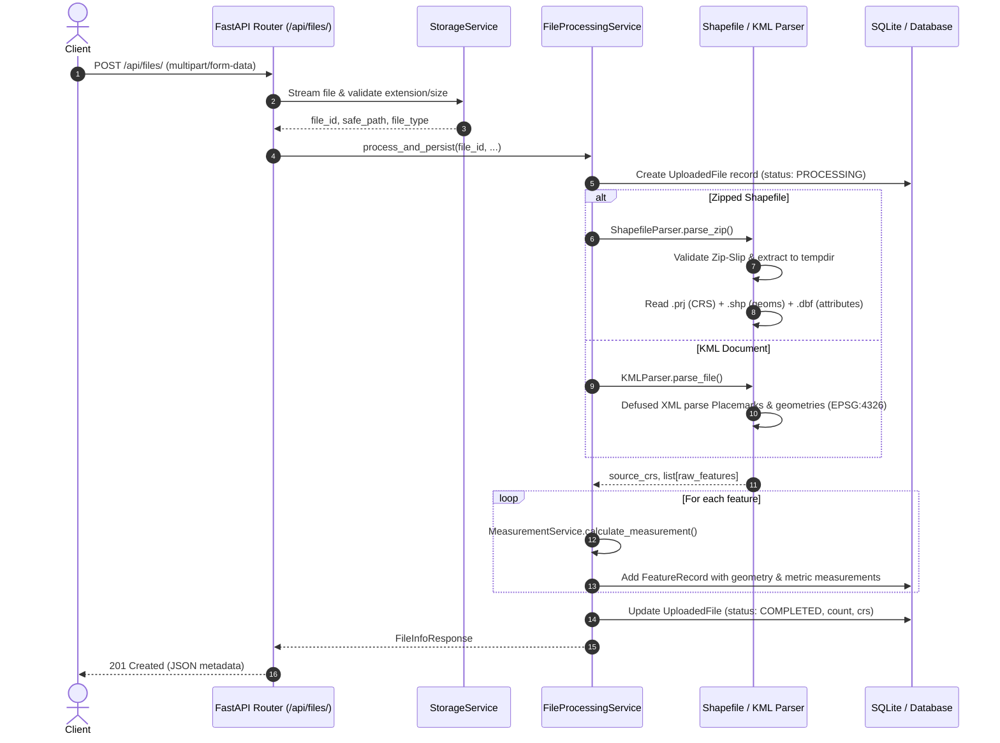
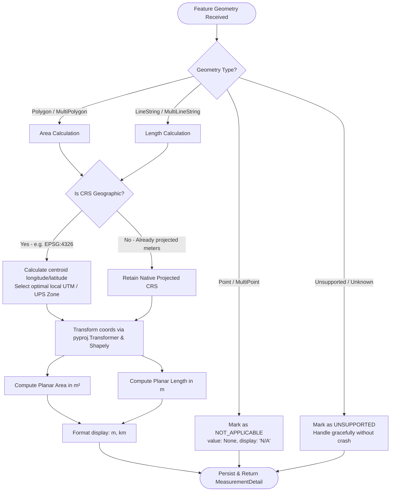

# Geospatial File Measurement API

A production-grade backend service built with **FastAPI**, **Shapely**, and **PyProj** that accepts geospatial vector files (**ESRI Shapefiles** and **OGC KML**), extracts spatial features, performs intelligent Coordinate Reference System (CRS) transformations, and computes metric measurements (Polygon Area and LineString Length).

---

## Table of Contents
1. [Overview & Key Features](#overview--key-features)
2. [Architecture](#architecture)
   - [Application Structure](#application-structure)
   - [File Processing Flow](#file-processing-flow)
   - [Measurement Calculation Flow](#measurement-calculation-flow)
   - [CRS Handling Strategy](#crs-handling-strategy)
3. [API Documentation](#api-documentation)
   - [Interactive Documentation](#interactive-documentation)
   - [Endpoints Summary](#endpoints-summary)
   - [API Reference & Examples](#api-reference--examples)
4. [Setup & Running Locally](#setup--running-locally)
   - [Prerequisites](#prerequisites)
   - [Method 1: Local Virtual Environment](#method-1-local-virtual-environment)
   - [Method 2: Docker & Docker Compose](#method-2-docker--docker-compose)
   - [Running Tests](#running-tests)
   - [Testing with Sample Data](#testing-with-sample-data)
5. [Technical Design Decisions & Trade-offs](#technical-design-decisions--trade-offs)
6. [Learnings & Future Scope](#learnings--future-scope)

---

## Overview & Key Features

- **Multi-Format Ingestion**: Supports `.zip` archives containing ESRI Shapefiles (`.shp`, `.shx`, `.dbf`, `.prj`) and OGC KML (`.kml`) files.
- **Dynamic Projected CRS Selection**: Intelligently detects geographic coordinates (`EPSG:4326`) and transforms geometries into local **Universal Transverse Mercator (UTM)** zones or conformal polar projections before calculating dimensions, eliminating lat/long degree distortion.
- **High-Precision Metric Calculations**:
  - **Polygons & MultiPolygons**: Area in square meters ($m^2$), with secondary human-friendly conversions (hectares, $km^2$).
  - **LineStrings & MultiLineStrings**: Planar length in meters ($m$), with secondary conversions ($km$).
  - **Points & MultiPoints**: Handled gracefully (`NOT_APPLICABLE`) per specification without failing.
  - **Unsupported Types**: Handles empty, malformed, or composite types (`GeometryCollection`) gracefully without server crashes.
- **Security Hardening**:
  - **Zip-Slip Protection**: Defends against directory traversal path attacks in uploaded `.zip` archives.
  - **Safe XML Parsing**: Uses `defusedxml` to block XML External Entity (XXE) and billion-laughs expansion attacks.
  - **Upload Size Limits**: Configurable file-size thresholds (default 50 MB) streamed safely in chunks.
- **Persistence**: Built on SQLAlchemy ORM with SQLite (drop-in replaceable with PostgreSQL/PostGIS in enterprise setups).
- **Comprehensive Test Suite**: 24 automated unit and integration tests passing in under 1 second.

---

## Architecture

### Application Structure

```text
Geospatial File Measurement API/
├── app/
│   ├── api/
│   │   ├── routes/
│   │   │   ├── files.py            # POST /api/files/, GET /api/files/{id}/, GET /api/files/{id}/measurements/
│   │   │   └── health.py           # GET /health
│   │   └── deps.py                 # Dependency injection (database sessions)
│   ├── core/
│   │   └── exceptions.py           # Custom domain exceptions and centralized error handlers
│   ├── db/
│   │   └── session.py              # SQLAlchemy engine and session factory
│   ├── models/
│   │   ├── base.py                 # DeclarativeBase model
│   │   └── file_record.py          # UploadedFile and FeatureRecord database entities
│   ├── schemas/
│   │   └── file_schemas.py         # Pydantic v2 validation models and response serializers
│   ├── services/
│   │   ├── crs_service.py          # CRS analysis, UTM zone resolution & coordinate reprojection
│   │   ├── measurement_service.py  # Area & length metric calculation engine
│   │   ├── shapefile_parser.py     # Safe zip extraction & Shapefile/DBF/PRJ parsing
│   │   ├── kml_parser.py           # Safe XML extraction for KML Placemarks & coordinates
│   │   ├── storage_service.py      # Secure file streaming and ID generator
│   │   └── file_service.py         # High-level orchestration and persistence facade
│   ├── config.py                   # Pydantic BaseSettings environment configuration
│   └── main.py                     # FastAPI application factory, middleware, route mounting
├── sample_data/
│   ├── sample_kml.kml              # Valid KML dataset (Polygon, LineString, Point)
│   └── sample_shapefile.zip        # Valid Zipped Shapefile dataset (.shp, .shx, .dbf, .prj)
├── scripts/
│   └── generate_sample_data.py     # Script to generate sample vector datasets
├── tests/
│   ├── conftest.py                 # Test fixtures & database lifecycle setup
│   ├── test_api_routes.py          # Integration tests for all REST endpoints
│   ├── test_crs_service.py         # Unit tests for UTM selection and coordinate transformations
│   ├── test_measurements.py        # Unit tests for geometry area/length calculations
│   └── test_parsers.py             # Unit tests for Shapefile and KML parsers & security
├── Dockerfile                      # Production container build
├── docker-compose.yml              # Container orchestration configuration
├── requirements.txt                # Pinned production dependencies
└── pyproject.toml                  # Project metadata and test configuration
```

### File Processing Flow



### Measurement Calculation Flow



### CRS Handling Strategy

#### 1. The Core Geospatial Challenge
When files store coordinates in geographic units such as **EPSG:4326 (WGS 84)**, coordinate values are angles (degrees latitude and longitude).
- $1^\circ$ of latitude is approximately $111\text{ km}$, but $1^\circ$ of longitude scales by $\cos(\text{latitude})$, shrinking from $\sim 111\text{ km}$ at the equator to $0\text{ km}$ at the poles.
- Calculating `.area` or `.length` on raw angular coordinates yields meaningless square degrees (e.g. $0.00001\text{ deg}^2$), which is unacceptable in GIS applications.

#### 2. Dynamic Projected CRS Selection
The service implements dynamic projected CRS resolution per geometry:
1. **Centroid Extraction**: Calculates the geographic centroid $(\text{lon}, \text{lat})$ in WGS 84.
2. **UTM Zone Formula**:
   $$\text{Zone} = \left\lfloor \frac{\text{lon} + 180}{6} \right\rfloor + 1 \quad (1 \le \text{Zone} \le 60)$$
3. **Hemisphere & EPSG Resolution**:
   - If $\text{lat} \ge 0^\circ$: Northern Hemisphere $\rightarrow \text{EPSG}:(32600 + \text{Zone})$ (e.g., Bangalore at $77.59^\circ\text{E}, 12.97^\circ\text{N}$ maps to **UTM Zone 43N / EPSG:32643**).
   - If $\text{lat} < 0^\circ$: Southern Hemisphere $\rightarrow \text{EPSG}:(32700 + \text{Zone})$ (e.g., Sydney at $151.20^\circ\text{E}, -33.86^\circ\text{S}$ maps to **UTM Zone 56S / EPSG:32756**).
4. **Polar Regions**: Latitudes $> 84^\circ\text{N}$ or $< -80^\circ\text{S}$ map to Universal Polar Stereographic (**UPS North EPSG:32661** / **UPS South EPSG:32761**).
5. **Existing Metric Projections**: If the input shapefile already defines a projected metric CRS (e.g., State Plane or existing local UTM), the native projection is preserved without distortion.
6. **Vectorized Transformation**: Coordinates are reprojected using cached `pyproj.Transformer` instances with high numerical precision.

---

## API Documentation

### Interactive Documentation
Once the server is running, interactive API documentation is available at:
- **Swagger UI**: [http://localhost:8000/docs](http://localhost:8000/docs)
- **ReDoc**: [http://localhost:8000/redoc](http://localhost:8000/redoc)

### Endpoints Summary

| Method | Endpoint | Description | Status Code |
| :--- | :--- | :--- | :--- |
| `POST` | `/api/files/` | Uploads and processes a `.zip` Shapefile or `.kml` file | `201 Created` |
| `GET` | `/api/files/{id}/` | Retrieves metadata, status, feature count, and CRS of a file | `200 OK` |
| `GET` | `/api/files/{id}/measurements/` | Retrieves feature-by-feature measurements, geometries, and aggregate summary | `200 OK` |
| `GET` | `/health` | Service health status and version probe | `200 OK` |
| `GET` | `/` | Root service descriptor | `200 OK` |

---

### API Reference & Examples

#### 1. Upload Geospatial File
`POST /api/files/`

**Request:** `multipart/form-data` with field `file`.

```bash
curl -X POST "http://localhost:8000/api/files/" \
  -H "accept: application/json" \
  -H "Content-Type: multipart/form-data" \
  -F "file=@sample_data/sample_kml.kml"
```

**Response (`201 Created`):**
```json
{
  "id": "e9a04a11",
  "filename": "sample_kml.kml",
  "feature_count": 3,
  "crs": "EPSG:4326",
  "status": "COMPLETED"
}
```

---

#### 2. Get File Information
`GET /api/files/{id}/`

**Request:**
```bash
curl -X GET "http://localhost:8000/api/files/e9a04a11/" \
  -H "accept: application/json"
```

**Response (`200 OK`):**
```json
{
  "id": "e9a04a11",
  "filename": "sample_kml.kml",
  "feature_count": 3,
  "crs": "EPSG:4326",
  "status": "COMPLETED"
}
```

---

#### 3. Get Feature Measurements
`GET /api/files/{id}/measurements/`

**Request:**
```bash
curl -X GET "http://localhost:8000/api/files/e9a04a11/measurements/" \
  -H "accept: application/json"
```

**Response (`200 OK`):**
```json
{
  "id": "e9a04a11",
  "filename": "sample_kml.kml",
  "crs": "EPSG:4326",
  "status": "COMPLETED",
  "summary": {
    "total_features": 3,
    "polygon_count": 1,
    "linestring_count": 1,
    "point_count": 1,
    "unsupported_count": 0,
    "total_area_sq_meters": 240409.8166,
    "total_length_meters": 550.8407,
    "total_area_hectares": 24.041,
    "total_length_km": 0.5508
  },
  "features": [
    {
      "feature_index": 0,
      "geometry_type": "Polygon",
      "geometry": {
        "type": "Polygon",
        "coordinates": [
          [
            [77.59, 12.97],
            [77.595, 12.97],
            [77.595, 12.974],
            [77.59, 12.974],
            [77.59, 12.97]
          ]
        ]
      },
      "crs": "EPSG:4326",
      "projected_crs": "EPSG:32643",
      "properties": {
        "name": "Parcel 101 - Agricultural Boundary",
        "description": "Zoned agricultural property boundary for drone surveying",
        "parcel_id": "AP-2024-001",
        "owner": "Aereo Agri Holdings",
        "crop_type": "Wheat"
      },
      "measurement": {
        "supported": true,
        "type": "area",
        "value": 240409.8166,
        "unit": "square_meters",
        "display": "240,409.82 m² (24.04 ha)",
        "status": "CALCULATED",
        "message": null
      }
    },
    {
      "feature_index": 1,
      "geometry_type": "LineString",
      "geometry": {
        "type": "LineString",
        "coordinates": [
          [77.5905, 12.9705],
          [77.5925, 12.972],
          [77.5945, 12.9735]
        ]
      },
      "crs": "EPSG:4326",
      "projected_crs": "EPSG:32643",
      "properties": {
        "name": "Corridor Alpha - Flight Path",
        "description": "Linear survey corridor flown by UAV",
        "corridor_id": "FP-01",
        "flight_speed_mps": "12.5"
      },
      "measurement": {
        "supported": true,
        "type": "length",
        "value": 550.8407,
        "unit": "meters",
        "display": "550.84 m",
        "status": "CALCULATED",
        "message": null
      }
    },
    {
      "feature_index": 2,
      "geometry_type": "Point",
      "geometry": {
        "type": "Point",
        "coordinates": [77.592, 12.9715]
      },
      "crs": "EPSG:4326",
      "projected_crs": null,
      "properties": {
        "name": "GCP 01 - Survey Station",
        "description": "High precision RTK-calibrated base benchmark",
        "station_id": "GCP-01",
        "accuracy_mm": "15"
      },
      "measurement": {
        "supported": false,
        "type": null,
        "value": null,
        "unit": null,
        "display": "N/A",
        "status": "NOT_APPLICABLE",
        "message": "Points have zero dimensions; no area or length measurement is required."
      }
    }
  ]
}
```

---

## Setup & Running Locally

### Prerequisites
- Python 3.11+ (Python 3.12 recommended)
- `pip` package manager
- Optional: Docker & Docker Compose

---

### Method 1: Local Virtual Environment

```bash
# 1. Clone repository
git clone <your-repo-url>
cd "Geospatial File Measurement API"

# 2. Create and activate virtual environment
python -m venv venv

# Windows:
.\venv\Scripts\activate
# Linux/macOS:
source venv/bin/activate

# 3. Install dependencies
pip install -r requirements.txt

# 4. Run database setup and launch server
uvicorn app.main:app --host 0.0.0.0 --port 8000 --reload
```

The API will be live at `http://localhost:8000`.

---

### Method 2: Docker & Docker Compose

Launch the entire stack with a single command:

```bash
# Build and run containerized service
docker compose up --build
```

To stop:
```bash
docker compose down
```

---

### Running Tests

Run the complete test suite with verbose output:

```bash
pytest -v
```

Output:
```text
tests/test_api_routes.py::test_health_check PASSED                       [  4%]
tests/test_api_routes.py::test_root_endpoint PASSED                      [  8%]
tests/test_api_routes.py::test_upload_and_measure_kml_flow PASSED        [ 12%]
tests/test_api_routes.py::test_upload_and_measure_shapefile_flow PASSED  [ 16%]
tests/test_api_routes.py::test_nonexistent_file_returns_404 PASSED       [ 20%]
tests/test_api_routes.py::test_unsupported_file_extension_returns_400 PASSED [ 25%]
tests/test_crs_service.py::test_parse_crs_standard_and_fallbacks PASSED  [ 29%]
tests/test_crs_service.py::test_is_geographic PASSED                     [ 33%]
tests/test_crs_service.py::test_determine_optimal_projected_crs_utm_zones PASSED [ 37%]
tests/test_crs_service.py::test_polar_crs_selection PASSED               [ 41%]
tests/test_crs_service.py::test_transform_to_crs_metric_dimensions PASSED [ 45%]
tests/test_measurements.py::test_polygon_area_calculation PASSED         [ 50%]
tests/test_measurements.py::test_multipolygon_area_calculation PASSED    [ 54%]
tests/test_measurements.py::test_linestring_length_calculation PASSED    [ 58%]
tests/test_measurements.py::test_multilinestring_length_calculation PASSED [ 62%]
tests/test_measurements.py::test_point_handling_graceful PASSED          [ 66%]
tests/test_measurements.py::test_unsupported_geometry_graceful PASSED    [ 70%]
tests/test_measurements.py::test_empty_geometry_graceful PASSED          [ 75%]
tests/test_parsers.py::test_parse_sample_shapefile PASSED                [ 79%]
tests/test_parsers.py::test_parse_sample_kml PASSED                      [ 83%]
tests/test_parsers.py::test_shapefile_missing_shp PASSED                 [ 87%]
tests/test_parsers.py::test_shapefile_corrupted_archive PASSED           [ 91%]
tests/test_parsers.py::test_shapefile_zip_slip_rejection PASSED          [ 95%]
tests/test_parsers.py::test_kml_malformed_xml PASSED                     [100%]

======================= 24 passed in 0.42s ========================
```

---

### Testing with Sample Data

Pre-packaged sample vector datasets are available in `sample_data/`:
1. `sample_data/sample_kml.kml` — Sample KML containing Polygons, LineStrings, and Points with attributes.
2. `sample_data/sample_shapefile.zip` — Sample Zipped Shapefile containing `.shp`, `.shx`, `.dbf`, and `.prj`.

To generate or refresh sample data at any time:
```bash
python scripts/generate_sample_data.py
```

---

## Technical Design Decisions & Trade-offs

| Decision | Selected Approach | Alternative Considered | Rationale |
| :--- | :--- | :--- | :--- |
| **Framework** | **FastAPI** | Django + DRF | FastAPI provides native asynchronous request processing, automatic OpenAPI/Swagger schema documentation, and high-performance validation via Pydantic v2 with minimal boilerplate. |
| **Geospatial Stack** | **PyShp + DefusedXML + Shapely + PyProj** | GDAL / Fiona / GeoPandas | Native GDAL/OGR C-bindings frequently lead to installation failures, compilation overhead, and platform-dependent shared library mismatches in Docker/cloud environments. `PyShp` and `Shapely 2.x` compile as self-contained wheels, ensuring instant 100% reproducible deployment across all operating systems. |
| **CRS Strategy** | **Dynamic Centroid-Based UTM** | Web Mercator (`EPSG:3857`) / Geodesic | Web Mercator causes massive surface area distortion away from the equator (up to 400%+ near polar regions). Dynamic local UTM preserves conformal geometric scale with $<0.04\%$ distortion, making it standard for surveying and drone photogrammetry. |
| **Security Architecture** | **Zip-Slip Defense & Defused XML** | Standard `zipfile.extractall` & `xml.etree` | Standard zip extractors are vulnerable to path traversal attacks targeting `/etc` or `system32`. Standard XML parsers are vulnerable to Billion Laughs and XXE injection. Security validations are strictly enforced before parsing. |
| **Persistence Layer** | **SQLAlchemy 2.0 + SQLite** | In-Memory Dictionary / PostGIS | File records, extracted features, and computed metrics persist across server restarts while requiring zero external database configuration. The repository layer cleanly abstracts migrations to PostgreSQL/PostGIS. |

---

## Learnings & Future Scope

### Key Learnings
1. **Coordinate Order & Standards**: KML strictly uses `(longitude, latitude, altitude)` ordering per OGC specifications, while GPS navigation APIs often interchange `(latitude, longitude)`. Standardizing coordinate normalization early prevented coordinate transposition errors.
2. **Python XML Element Falsiness**: In `xml.etree.ElementTree`, an element with no child elements evaluates as `False` in boolean contexts (`bool(elem) == False`). Using Python `or` chaining on XML lookups can silently drop valid elements with text. Namespace-agnostic helper functions resolved this cleanly.
3. **Multi-Part Geometries**: Survey parcels often include split boundaries (`MultiPolygon`) or broken survey paths (`MultiLineString`). Aggregating individual component dimensions ensures mathematical correctness without data loss.

### Future Scope & Production Roadmap
- [ ] **Surface 3D Elevation Modeling**: Incorporate Digital Elevation Models (DEM) / GeoTIFF rasters to compute slope-adjusted terrain surface area and 3D flight corridor distances.
- [ ] **Asynchronous Task Queue**: Integrate **Celery / Redis** for background processing of large shapefiles (>100,000 features) with WebSocket progress updates.
- [ ] **Spatial Database & PostGIS**: Migrate persistence to PostgreSQL with PostGIS extension for spatial index queries (`ST_Area`, `ST_Length`, bounding box intersections).
- [ ] **Export & Conversion APIs**: Add export endpoints (`GET /api/files/{id}/export?format=geojson|geopackage`) for seamless GIS interoperability with QGIS and ArcGIS.
- [ ] **Cloud Object Storage**: Connect S3 / Google Cloud Storage buckets for durable storage of multi-gigabyte aerial datasets.
